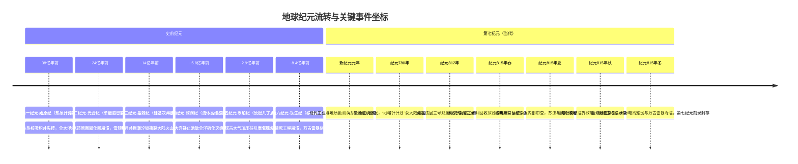

# 《梦痕纪元》故事圣经（Story Bible）

> **版本**：v1.0（L0 故事圣经与全书总纲锁定版）  
> **定位**：百万字硬科幻/地质哲学史诗长篇小说创作根基  
> **纪元锚点**：第七纪元·智人末期（主叙事层）与史前纪元交错  

---

## 一、 主题与哲学基调

### 1. 核心主题：浮生若梦
- **纪元轮替与文明的微热**：在地球长达四十五亿年的物理历史中，智慧文明并非孤例，而是如同一场场季节性发作的行星高热。每一个自负登顶的智慧种族，都以为自己是星球漫长等待的终点与主人；但在数十亿年的地质尺度面前，千万年乃至数十万年的鼎盛文明史，不过是地表岩层中甚至无法形成一毫米厚度夹层的微弱闪光。
- **庄周梦蝶的宏观科学化**：当第七纪元的地壳物理开发员林拓的大脑神经与远古岩石中的残留磁畴发生非线性共振，他读取到了八亿年前第六纪元末代重构师瑟恩的意识。究竟是林拓在地下二十八公里的观测井中读取了远古的幻梦，还是八亿年前面临灭顶之灾的瑟恩在烈焰与雷鸣中梦见了数亿年后一颗冰冷行星上的机械观测者？繁华与虚无、科技与灰烬，在时间长河中模糊了主客体界限。

### 2. 核心命题：地球从未被征服
- **大地的绝对主权**：地球从来不是任由智慧生命肆意切割驯服的被动物体。大地不需要被拯救，也未曾真正被奴役。人类与前代文明对行星能源与结构的“终极开发”，非但不是对大自然的加冕，反而是打破了行星深层自平衡的触机。
- **文明覆灭的内生律**：毁灭从未来自外星舰队的降维打击或宇宙神明的降罚，每一次璀璨纪元的落幕，都源于文明发展到极致后的狂妄自负与不可逆开发。大地只是以冷酷的物理规律自然翻身，自负的造物便在数日或数年间被彻底抹平。

### 3. 情感基调：厚重烟火与苍凉史诗的交融
- 拒绝悬浮空洞的技术口号。故事的根深扎在有血有肉的人间日常中——咖啡的焦苦、清晨窗幕上的冷凝水、阳台上濒死的绿萝、伴侣对休假与暖气补贴的惦念、轮班工人的机油与汗水。
- 唯有将人物作为活生生、有羁绊、有疲惫的生命体去刻画，当他们在不可逆的浩瀚历史律动与地质终局面前做出抉择时，毁灭的悲剧性与超越时间的诗意才具有震撼人心的力量。

---

## 二、 世界观三大核心物理法则

### 1. 地质清洗律（The Law of Geological Oblivion）
- **无化石、无废墟、无金属残留**：现代古生物学与地质学之所以从未发掘出史前神级文明的任何遗存，并非因为文明未曾存在，而是因为“地球的胃袋与磨盘”。
- **物理清洗机制**：
  - **板块俯冲与地幔对流**：大洋板块带着一切宏伟的沿海巨构与深海地基滑入海沟，潜入数百公里的高温高压地幔熔炉中彻底重熔（地幔对流循环周期约数亿年）。
  - **造山运动与超深变质作用**：大陆碰撞将地表建筑、合金框架碾碎为结晶片岩与片麻岩，矿物在千度高温与超高压下重新结晶，分子级人造晶格被彻底打乱。
  - **亿年风化与水力搬运**：风雨、冰川循环剥蚀剥离地表，即便由坚硬钛合金或人造金刚石构筑的地表纪念碑，在数千万至数亿年的物理风化与化学侵蚀下，也会被分解为微观粉尘与黏土矿物。
- **结论**：人类脚下的广袤原始荒野、深海海盆与壮丽山脉，并非蛮荒的处女地，而是早已反复消化、洗刷过数十次神级文明血肉与钢铁的墓床。

### 2. 天地刻录律（The Law of Lithomagnetic Inscription）
- **大地即光盘**：人造的人文记录（书籍、光盘、固态硬盘、云端量子库）在数万年内均会降解归零。唯有行星级的极端自然物理过程，能将瞬间的信息以自然印迹留存。
- **物理刻录机制**：
  - **文明失控诱发的能量极值**：当超级自负工程跨越临界点崩塌时，剧烈释放的超高能量在对流层与电离层引发撕裂大陆的“超极雷暴”，或诱发太阳磁力线重连导致毁灭性的“超级耀斑反冲”。
  - **古地磁畴与居里点锁定**：千亿伏特的雷电流或极高能等离子体束击穿地表岩石，使岩层局部温度骤升至居里点（Curie Point）以上，岩石中的磁铁矿、赤铁矿等磁性矿物晶格发生瞬间退磁与重新排列；在降温淬火的微秒间，大地如同一块被高能磁头写入的磁盘，将强电流周围的电磁波动、文明网络的尖叫以及无数生物脑电波的共振频段，永久“冻结”在矿物的剩余磁化矢量中。
  - **深源留存**：这类岩体被后续的地壳深部挤压封存（如深源闪电岩），逃过了浅层风化，在地质暗处静待读取。

### 3. 浮生若梦法则（The Principle of Fleeting Reverie）
- **意识纠缠与时空对称**：高级智慧生命的神经系统（无论是碳基神经元突触还是硅基晶络）本质上是复杂的微观电磁与量子相干体系。
- **读取的非机械性**：当现代开发员的神经勘测接口以特定微波/磁共振频率激励深源闪电岩的异常磁畴时，发生的不是计算机对结构化文件的“解码”，而是意识的主动沉浸与双向穿梭。
- **跨时空共鸣的悖论**：在亿万年两端的两个智慧个体，在走向文明落幕的同一种自负与绝望中，脑电波频谱产生了跨越时空的宏观量子驻波。他们既是彼此历史的见证人，又是彼此大梦中的幻影。

---

## 三、 纪元编年史与文明谱系表（Epochal Chronicle）

| 纪元代号 | 时代估算距今 | 优势物种形态与基底 | 文明特征与技术高峰 | 自负工程（毁灭诱因） | 覆灭机制与天地异象 | 刻录介质与遗存形式 |
| :--- | :--- | :--- | :--- | :--- | :--- | :--- |
| **第一纪元·始原纪** | ~38亿年前 | 原初深海热泉非均相超分子聚合体 | 建立覆盖全大洋底部的热液化学逻辑网络，具备无定型分子计算 | **“地心热核吸积井”**：试图强行加速地核热平衡以维系全球均温 | 引发全球海底玄武岩大规模裂解脱气，大洋沸腾酸化 | 早期条带状铁矿建造（BIF）中的超微纳米交错磁层 |
| **第二纪元·光合纪** | ~24亿年前 | 巨型群体单细胞自组装生物群落 | 绝对掌控厌氧生物化学，构建全球生物胶质巨穹 | **“大气还原圈固化网”**：阻断氧气产生，试图永久维持无氧温室 | 诱发全球暴发性不可逆产氧事件（大氧化灾变）与“雪球地球”大冰期 | 蓝田生物群地层深部微晶白云岩中的古氧同位素与剩磁异常 |
| **第三纪元·晶棘纪** | ~14亿年前 | 硼硅骨架多肢棘皮智慧体 | 低温超导晶体建筑，运用行星次声波与地潮引力做工 | **“地月共振潮汐锁”**：试图调节地月距离以固定全球引力潮汐常数 | 地月轨道摄动引发全球超强地壳破裂，超级火山链连环喷发 | 深度变质石英岩中的树状微观相变冲击晶格与磁性包裹体 |
| **第四纪元·深渊纪** | ~5.8亿年前 | 泛水生软体高维感知生物群（埃迪卡拉先驱） | 以流体涡旋记忆与全球深海次声波构筑共振智慧圈 | **“大洋环流绝对静止池”**：试图消除风浪海洋耗散，建立永恒层流 | 导致深海绝对缺氧与全大洋毒化硫化，生态链瞬间断裂 | 黑色页岩夹层中富含有机质的黄铁矿结核磁性排列 |
| **第五纪元·翠珀纪** | ~2.9亿年前 | 巨型拟节肢气管共鸣文明 | 依靠石炭纪极高氧环境发展出超致密几丁质机械与化学喷气工业 | **“全球古大气加压桩”**：人为封存全大陆森林以无限提高全球气压与氧分压 | 引发席卷全大陆的自燃性不可灭超级火风暴与超基性大火成岩省 | 煤层底板超高温烧结黏土岩与天然焦磁性柱状节理 |
| **第六纪元·钛生纪** | ~8.4亿年前 | 碳硅共生晶格生命体（瑟恩） | 意识与电磁共振直连，悬浮重构建筑，光极与重力场调控 | **“行星磁极锁死工程”**：试图消除地磁倒转与极移，锁定全球地磁秩序 | 引发地磁发电机崩溃撕裂，诱发万古全球雷暴，电磁脉冲熔融地壳 | **深源闪电岩（Deep Fulgurite）**：暗青玄黑超基性岩中的树状熔融石英脉 |
| **第七纪元·智人纪** | **当代（主线）** | 碳基灵长类人类（林拓、苏沫） | 电磁、航天、核能、深地工程、行星级资源统合开发 | **“地幔针计划（Project Mantle Needle）”**：穿刺莫霍面，转化地幔对流与行星磁阻为永久能源 | 诱发地幔热对流失稳反冲与电离层风暴，全球地磁场崩溃重构 | **莫霍井深层熔岩结晶**：在钻探井残迹中淬火而成的新一轮磁痕记录 |
| **第八纪元（预留）** | 未来~6亿年 | 远期后生硅基电离形态（启示投影） | 诞生于大氧化大灭绝后新大陆的大气电离智慧群 | **“太阳辐射俘获伞”**：试图阻遏太阳光度自然上升对地球的蒸发 | 引发极端温室失控与大气光解逃逸 | 预留于未来地质柱状剖面 |

---

## 三（续）、 第一至第五纪元遗存介质与关键细节补齐

为支撑百万字长篇体量中跨纪元解密与世界观层层抽丝剥茧的需要，前五个纪元的自然刻录介质与关键探索细节补齐建档如下：

1. **第一纪元·始原纪（~38亿年前）**
   - **核心技术/意识形态**：非均相超分子凝聚态。无个体概念，依靠全大洋底部的热液硫化物晶体点阵进行慢速化学运算，每一个热泉喷口是一个算力节点。
   - **自负工程详情**：**“地心热核吸积井”**。始原文明误判了年轻地球的冷却速率，试图用万座深海引力沉降柱向地核注入高密度流体以强行锁定地核热对流。
   - **刻录介质档案**：**“始新隐晶条带磁铁矿”（Eo-Cryptic BIF）**。产于最古老克拉通（如格陵兰伊苏阿带、西澳皮尔巴拉深部下地壳）。在全大洋沸腾酸化的那一瞬间，海水中的低价铁离子被万古闪电光致氧化，以亚微米级磁铁矿层沉积。其晶格中封存着始原文明最后一次全球热化学震荡的频率。

2. **第二纪元·光合纪（~24亿年前）**
   - **核心技术/意识形态**：原核生命集约智联。以巨型胶质垫和地表滤光穹顶统领全球，视“氧气”为最剧烈的剧毒废气。
   - **自负工程详情**：**“大气还原圈固化网”**。在全地表铺设数百万平方公里的碳氢抑制膜，强行中和正在萌芽的产氧蓝细菌，企图将地球永远禁锢在还原性温室中。
   - **刻录介质档案**：**“冰盖淬火白云岩”（Glacial Quenched Dolomite）**。大氧化灾变引发全球“雪球地球”大冰期，在赤道冰层合拢的最后一刻，万古寒流与暴烈阳光在碳酸盐岩表层留下了奇异的古地磁倾角异常跳跃与微晶包裹体，读取时伴随极度严寒与窒息的群体恐慌感。

3. **第三纪元·晶棘纪（~14亿年前）**
   - **核心技术/意识形态**：多肢硼硅晶骨生命。无喉部与声带，通过摩擦骨骼发射超长次声波交谈；建筑为倒悬于大陆架断崖的巨型单晶硅钟乳塔群。
   - **自负工程详情**：**“地月共振潮汐锁”**。在赤道周天架设十二座引力微调塔，试图抵消月球远离造成的潮汐减速，将每天时长锁定为恒定的18小时。
   - **刻录介质档案**：**“超压冲击石英金刚石角砾”（Stishovite Breccia）**。引力失衡引发超级地幔柱喷发，超高压冲击波将单晶建筑瞬间碾成含有纳米金刚石与超石英晶相的角砾岩。其内部包裹着强残磁磁黄铁矿，读取时能听到撕裂骨骼的刺耳次声波啸叫。

4. **第四纪元·深渊纪（~5.8亿年前）**
   - **核心技术/意识形态**：高维拓扑软体群。身体形态如同叶状或盘状的半透羽饰，利用深海流体涡旋编码哲学与艺术，社会极度沉静优美。
   - **自负工程详情**：**“大洋环流绝对静止池”**。为了避免海流冲垮精细脆弱的群体构网，建造了横跨大洋中脊的洋流减速坝，强行消除深海涡流。
   - **刻录介质档案**：**“化硫层草莓状黄铁矿磁核”（Framboidal Pyrite Cores）**。洋流静止导致全球海洋硫化大缺氧，在万亿生命沉入海底被黄铁矿化的瞬间，古地磁场记录了无声滑向永眠的深邃宁静与绝望。

5. **第五纪元·翠珀纪（~2.9亿年前）**
   - **核心技术/意识形态**：致密节肢几丁质机械工匠。拥有高度发达的纯化学动力与高压气动工程，挖掘通达地幔浅层的超级烟道。
   - **自负工程详情**：**“全球古大气加压桩”**。将巨型石炭森林用耐火沥青包裹下压，企图将大气压提升至五个标准大气压以满足重型飞行器的浮力极限。
   - **刻录介质档案**：**“焦化层磁性柱状玄武岩”（Pyrolytic Columnar Basalt）**。自燃大火点燃了全大陆煤层与地幔柱，玄武岩熔岩流在接触超高温焦炭层时瞬间淬火，柱状节理中锁定了千万公顷烈火焚城的恐怖电磁噪声。

---

## 四、 核心人物谱与全生命弧光档案（Character Roster）

### 1. 林拓（Lin Tuo）—— 主角（第七纪元）
- **身份**：第三大陆深地开发署·第七勘测局在编二级地质物理开发员（工号：M03-7749）。
- **性格特质**：
  - **外表冷峻内敛**：常年深地作业塑造了他寡言、敏锐、对物理规律近乎洁癖的尊重。
  - **深藏的温情与留恋**：极度眷恋地表的阳光、伴侣身上的烟火气与生活琐事，但在深潜工作中压抑感情。
  - **知行合一的韧性**：不盲从狂热权威，当事实推翻既有信仰时，能够以惊人的理智直面冰冷残酷的真相。
- **常态化着装**：
  - **作业状态**：深石墨色“深潜轻压外骨骼工服”。微孔耐高温陶瓷纤维面料，哑光质感；钛合金支撑导轨咬合于双肩与腰椎两侧；胸前斜跨高压液压安全套索；领口为硬质磁吸密闭环，内嵌淡琥珀色生命体征脉冲光环；左小臂固定半柔性触控副屏，手戴磨损严重的聚合物防震手套，指关节满是炭灰色岩粉擦痕。
  - **日常生活**：洗得发灰的深藏青色软质聚酯抓绒衫，宽松工装灰长裤，鞋底磨平大半的软底步行靴。领口常随意敞开，眼神带着倒班工人的淡漠与微倦。
- **人际关系**：
  - 与苏沫：彼此支撑的避风港与最深羁绊；在冷酷世界里共同构筑生活实感。
  - 与魏世昌：师徒与上下级；敬重其经验，但随着项目推进在理念上产生根本撕裂。
  - 与沈明漪：从互相防备的数据复核对手，转变为共享禁忌真相的地下盟友。
- **人物全书弧光**：
  - **起点**：笃信现代科技、遵守操作规程的技术中产螺丝钉，只求按部就班退休换取地表大生态仓。
  - **转折**：偶然触碰深源闪电岩，读取第六纪元记忆，世界观遭受粉碎性冲击；逐步在多井段复核中确立纪元轮回律。
  - **高潮**：在文明自负走向不可逆的反噬临界点时，放弃无谓逃亡与空洞英雄主义，选择作为清醒的“纪元见证人”。
  - **终局**：平静走向毁灭，以肉身与意识接入最后淬火的岩石，完成新纪元磁痕的刻录闭环。

### 2. 苏沫（Su Mo）—— 核心女主（第七纪元）
- **身份**：地表第三生态环城市规划局·历史地理资料处三级档案员。
- **性格特质**：温和、务实、细致敏锐。对宏大宣传保持本能的疏离感，对数字与地质档案的历史缺失具有学者特有的直觉。深爱林拓，是他维系人性与理智的锚。
- **常态化着装**：浅杏色针织开衫，内衬浅灰色棉质长裙；乌黑长发用一根暗色桃木发簪松松挽在脑后；手腕常年佩戴一块老式双指针地表光照手环（机械发条与光敏结合）。
- **人物全书弧光**：
  - **起点**：操心柴米油盐、水电补贴与生活舒适度的小职员。
  - **发展**：在林拓的委托下，利用档案权限私下核查“地幔针全线穿刺区”的历史测绘资料，意外发现了百年来被科学界刻意抹杀或归类为“测绘噪点”的超深层古地磁异常断层图谱。
  - **升华**：在地表秩序陷入混乱与电离风暴席卷城市时，没有陷入恐慌崩溃，而是沉着地完成了对地表档案的物理微缩封存，在阳台的绿萝旁见证了天空的异象，与深地的林拓达成跨越空间的意念告别。

### 3. 瑟恩（Soren）—— 跨纪元对照主角（第六纪元·钛生纪）
- **身份**：第六纪元末期，行星磁场调谐总署末代磁序重构师。
- **生物形态与外貌**：碳硅共生体。躯干表面呈现半透明结晶质感，皮下流动着微弱的淡蓝与翠绿导电离子流；后脑与颈椎分布有六枚外露的六角形骨质磁极接头；无毛发，双眸覆盖单向偏光黑色晶片。
- **常态化着装**：“柔性液态晶络袍”。宛如蝉翼的半透明导电薄膜，衣摆边缘恒定维持着数毫米的静电斥力力场，行走时离地浮空，不生摩擦。
- **人物全书弧光**：
  - 与林拓形成跨越八亿年的完美镜像。曾是第六纪元“磁极锁死工程”的核心主导者之一，狂热相信文明能够终结地球磁场漂移。在亲眼目睹地磁撕裂、天火焚城的最后时刻，精神崩溃并最终转化为极致的清醒，将自身意识与文明悲歌借由超极雷暴烙入岩石深处。

### 4. 魏世昌（Wei Shichang）—— 秩序守护者与悲剧权威（第七纪元）
- **身份**：深地开发署莫霍钻探工程总总工程师，林拓的导师与引路人。
- **性格特质**：坚韧、铁血、功利性科学主义者。经历过年轻时代的地表能源饥荒，坚信“唯有彻底降服地核，文明才有尊严”。
- **常态化着装**：深藏青色重型工程指挥防尘大衣，胸前挂满各级别深潜勋章与实体辐射剂量检测牌，头发花白修剪成极短的板寸，眼眶深陷，手指因早期冷凝剂冻伤而关节变形。
- **人物全书弧光**：从器重林拓到将其视为“精神疲劳与反动悲观主义者”，在数据异常面前不断动用权力压制报告；最终在地幔针失控引发全球反冲的指挥台上，亲眼看着仪表盘熔化，在信念坍塌的巨大绝望中与工程同归于尽。

### 5. 沈明漪（Shen Mingyi）—— 青年反叛科学家（第七纪元）
- **身份**：行星地球物理研究所（IGP）极端环境流动观测组组长，特级数据分析员。
- **性格特质**：孤傲、毒舌、极度崇拜数学真实。对行政官僚与政绩工程深恶痛绝，追查深层地磁微脉冲的狂热者。
- **常态化着装**：白色高领防磁服，外套一件敞开的黑色多口袋战术勘测马甲，鼻梁上架着一副全息数据复核护目镜，手指上戴着两枚数据解密密钥环。
- **人物全书弧光**：起初奉命暗中调查林拓在莫霍三号井的“违规误操作与数据瞒报”，但在复核原始磁化率张量后，被数学模型的完美一致性所震撼；从调查者转变为林拓的地面最强协作者，最终在地表测绘台站记录下全球地磁崩溃的完整光谱。

### 6. 陆崇远（Lu Chongyuan）—— 体制与权力的具象化（第七纪元）
- **身份**：第三大陆能源与资源统筹委员会高级常务专员。
- **性格特质**：优雅、精算、冷血的政治官僚。深知地幔针项目蕴含的地缘与政治红利，任何技术风险在其眼中都不过是“可接受的损耗率”。
- **常态化着装**：挺括的炭黑色高分子防皱行政西装，领口佩戴代表大陆联合能源署的金色双螺旋徽章，左手腕佩戴一块显示大陆能源消耗与资本流动的超薄金环。
- **人物全书弧光**：全书自负与体制狂妄的推手。数次驳回林拓与沈明漪的技术熔断预警，强推超功率深刺；直到最后的灾难降临前夕，仍在防空避难堡垒中起草“能源胜利宣言”，最终与深层地堡一同被深源应力撕碎。

---

## 五、 关键场景语言档案（Scene Profiles）

### 1. 莫霍浅层三号观测井（Moho Station-03）
- **空间位置**：地下28.4公里，莫霍不连续面以上两公里。
- **样貌描摹**：
  位于超深绝热球形人工空腔内，直径约120米。四壁由数万块蜂窝状灰白色耐热压氧化锆复合陶瓷板紧密嵌合，板缝间恒定流淌着淡蓝色低温氟碳冷却液的光晕。
  中央悬跨着一条宽仅两米的重型钛合金检修钢桥。钢桥下方是翻滚着暗红色暗光的能量屏蔽力场，透过力场隐约可见深部超基性岩层因地温高达600℃而散发的暗哑热光。
  空气中弥漫着高压放电导致的干燥臭氧味与硅酸盐微尘的焦糊气。头顶盘旋着八组巨型环形吸气换热管道，永恒发出低沉震颤的次声共振，仿佛一只潜伏在地幔边缘的巨兽在持续喘息。

### 2. 深源闪电岩（Deep Fulgurite Core）
- **样品规格**：长约45厘米，直径约8厘米的不规则圆柱体岩芯。
- **样貌描摹**：
  通体呈现出一种吞噬光线的深玄青色与墨黑色交织质感，外壳光滑如淬火黑曜石。在岩芯纵剖面正中，贯穿凝固着一道树状分叉的微细脉络，脉络呈现乳白色的熔融超石英相。
  在完全遮光的暗室中，这道树状白色脉络因岩石晶格内被囚禁的巨量残余磁能与微弱自发极化，会向外渗出一层微弱、冰冷、宛如幽灵般闪烁的苍灰荧光。手掌靠近至五厘米内，皮肤上的汗毛会因静电场而根根竖立。

### 3. 北三区“栖水里”居住单元与地表城市
- **空间位置**：地表第三生态环城市边缘，第72层。
- **样貌描摹**：
  典型的第七纪元中晚期高密度垂直塔楼，外壁泛着自洁纳米涂层长期剥蚀留下的灰白水渍。
  室内空间约45平方米，极简紧凑。落地窗由三层厚重的防辐射复合树脂构成，窗外常年笼罩着灰蒙蒙的低空酸雨云层与交织穿梭的封闭式悬浮交通磁轨。极目远眺，刺破重重铅云的天空正中央伫立着高耸入云的“天幔吸收塔”，其巨大的电离收集冠在昏暗天际线上有节奏地吞吐着暗橙色的光环。
  室内充盈着空气循环过滤系统释放出的微弱人造柠檬烯香气，阳台角落里的透明恒温玻璃罩内，悬挂着一小盆叶缘焦黄的古老绿萝，那是被工业化城市严密圈养的微弱自然孑遗。

### 4. 天幔吸收塔（Sky-Mantle Canopy Tower）
- **空间位置**：第三大陆核心地带，地表天际线中心。
- **样貌与技术机制**：
  高达数千米的黑色合金巨构，直径超过三百米，通体由铅锂复合装甲与高压绝缘环层叠构成，笔直刺入低垂铅云。
  塔顶设有覆盖城市上空的巨型环形电离收集冠，通过受控强电磁场捕获对流层顶与低电离层的游离电离能量，为地表城市网格提供基底负荷。
  **运行瓶颈与衰退史**：作为第七纪元早期的超级工程，随着长期电离抽吸导致空间带电粒子通量递减，其转化效率已陷入严重瓶颈；顶冠吞吐的暗橙色电离辉光日益暗淡，供能缺口迫使文明最终转向深地“地幔针计划”。

### 5. 升降深井·零号枢纽（The Vertical Well - Hub Zero）
- **空间位置**：地表与深地开发区的中枢交接面。
- **样貌描摹**：
  垂直跨度达200米的宏伟圆柱形钢铁穹顶，由无数道高张力粗钢缆、高压液压管线与排风井道编织成一片密不透风的机械丛林。
  地面铺设着鲜明厚重的黄黑相间工业防滑反光漆，数以万计身着石墨色、醒目橙色工程防护服的工人、技师与安全员在交错的网格线上奔行。中央排列着八座直径达十五米的磁悬浮深潜吊舱，每隔数分钟，伴随着震耳欲聋的高压气压释放与滚滚白雾，钢铁吊舱如断头台的闸刃般沉入深不可测的黑色垂直井坑。机油味、合成便当香精味与人体汗液蒸发的气味在高温高压气流中胶着盘旋。

---

## 六、 宏观时间线与纪元大事件表（Chronological Milestones）

---

## 七、 核心锁定专有名词表（Locked Lexicon）

为确保后续百万字创作全程绝对严密、名词零漂移，以下专有名词与物理概念永久封存：

| 专有名词 | 英文/代号 | 归属纪元/范畴 | 严格定义与说明 |
| :--- | :--- | :--- | :--- |
| **林拓** | Lin Tuo | 第七纪元（主线） | 高级地壳物理开发员（工号M03-7749），本书第一视点核心人物。 |
| **苏沫** | Su Mo | 第七纪元（主线） | 林拓伴侣，地表第三生态环城市规划局档案员。 |
| **瑟恩** | Soren | 第六纪元·钛生纪 | 末代磁序重构师，碳硅共生晶格生命，被读取者。 |
| **地幔针计划** | Project Mantle Needle | 第七纪元终极工程 | 人类穿刺莫霍面、调控地幔热流与行星磁阻的超级自负工程。 |
| **莫霍浅层三号观测井**| Moho Station-03 | 第七纪元作业面 | 地下28.4公里处绝热防压球形观测基站，林拓常驻工作地。 |
| **深源闪电岩** | Deep Fulgurite Core | 物理/跨纪元介质 | 8.4亿年前第六纪元毁灭雷暴瞬间淬火封存的超基性岩心，信息载体。 |
| **钛生纪** | Titanian Epoch | 第六纪元代号 | 距今约8.4亿年的辉煌碳硅晶格文明时代。 |
| **天幔吸收塔** | Sky-Mantle Canopy Tower | 第七纪元地表巨构 | 地表耸入云端的数千米级电离层能量接收装置，地表天际线标志物；目前面临粒子通量递减与效率瓶颈。 |
| **升降深井·零号枢纽** | The Vertical Well - Hub Zero | 第七纪元交通中枢 | 连接地表垂直悬浮交通与地下二十余公里工程井的巨型中转大厅。 |
| **地质清洗律** | Law of Geological Oblivion | 世界观根本法则 | 地壳运动、板块俯冲与亿年风化抹平一切人造物理残骸的客观规律。 |
| **天地刻录律** | Law of Lithomagnetic Inscription| 世界观根本法则 | 超极雷暴与太阳耀斑改写岩石磁畴排列、记录文明覆灭瞬态的物理过程。 |
| **浮生若梦法则** | Principle of Fleeting Reverie| 世界观哲学法则 | 智慧生命的繁衍更迭为地球短暂微热、跨纪元意识纠缠的科幻表述。 |
| **居里锁定** | Curie-Lock Event | 地质物理术语 | 岩石越过居里点冷却时永久捕获当时外部地磁矢量与电磁波动的瞬间。 |
